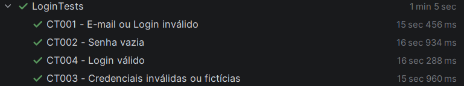
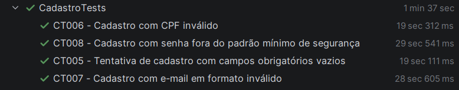
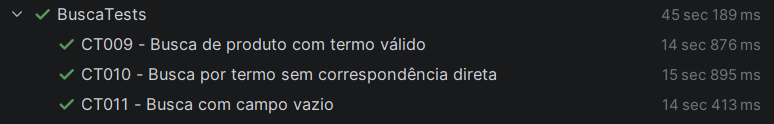
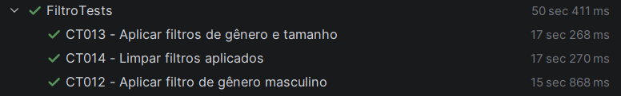
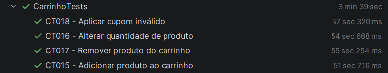

# Automação de Testes E2E - Lojas Renner

Projeto de automação de testes funcionais End-to-End (E2E) desenvolvido como estudo de caso para o **Projeto Científico FADERGS**.

A suíte utiliza **Java 21, Selenium WebDriver, JUnit 5, Maven e Page Object Model (POM)** para validar fluxos do e-commerce Lojas Renner diretamente pela interface da aplicação.

## Resultado final

```text
20 testes executados
20 testes aprovados
0 falhas
Taxa de aprovação: 100%
Tempo de execução: 8 min 33 s
```

---

## Objetivo

Desenvolver uma suíte automatizada para validar fluxos relevantes de um e-commerce real, aplicando conceitos de Qualidade de Software, testes funcionais de caixa-preta e automação E2E.

Funcionalidades cobertas:

- Login
- Cadastro
- Busca de produtos
- Filtros
- Carrinho de compras
- Recuperação de senha

---

## Tecnologias utilizadas

| Tecnologia | Versão | Finalidade |
|---|---:|---|
| Java | 21 | Linguagem principal |
| Selenium WebDriver | 4.34.0 | Automação do navegador |
| JUnit 5 | 5.13.4 | Execução e validação dos testes |
| Maven | - | Gerenciamento de dependências |
| Maven Surefire Plugin | 3.5.3 | Execução da suíte |
| dotenv-java | 3.0.0 | Variáveis de ambiente |
| Google Chrome | - | Navegador utilizado |
| IntelliJ IDEA | - | Desenvolvimento e execução |
| Git / GitHub | - | Versionamento |
| Page Object Model | - | Organização da automação |

---

## Arquitetura

O projeto utiliza **Page Object Model (POM)**, separando os casos de teste dos seletores e das ações realizadas na interface.

```text
src/test/java/
├── base/
│   └── BaseTest.java
├── pages/
│   ├── BasePage.java
│   ├── LoginPage.java
│   ├── CadastroPage.java
│   ├── BuscaPage.java
│   ├── FiltroPage.java
│   ├── CarrinhoPage.java
│   └── RecuperacaoSenhaPage.java
├── tests/
│   ├── LoginTests.java
│   ├── CadastroTests.java
│   ├── BuscaTests.java
│   ├── FiltroTests.java
│   ├── CarrinhoTests.java
│   └── RecuperacaoSenhaTests.java
└── utils/
    ├── ConfigReader.java
    └── DriverFactory.java
```

Principais responsabilidades:

- **BaseTest:** abertura e encerramento do navegador.
- **BasePage:** operações comuns como espera, clique, digitação e rolagem.
- **Pages:** seletores e ações de cada funcionalidade.
- **Tests:** cenários, dados utilizados e validações.
- **DriverFactory:** criação e configuração do ChromeDriver.
- **ConfigReader:** leitura das variáveis do arquivo `.env`.

Para o cenário de login válido:

```env
APP_USER=usuario
APP_PASS=senha
```

O arquivo `.env` não é versionado.

---

## Estratégia de testes

Foram aplicadas técnicas de teste funcional de caixa-preta, incluindo:

- Partição de Equivalência;
- Análise de Valor Limite;
- cenários positivos e negativos;
- combinação de condições;
- transição de estados.

Como a automação utiliza uma aplicação pública real, foram evitadas operações como pagamento real, bypass de CAPTCHA, OTP, acesso a e-mail e alteração efetiva de senha.

---

## Cobertura

| Módulo | Casos | Resultado |
|---|---|---:|
| Login | CT001 a CT004 | 4/4 ✅ |
| Cadastro | CT005 a CT008 | 4/4 ✅ |
| Busca | CT009 a CT011 | 3/3 ✅ |
| Filtros | CT012 a CT014 | 3/3 ✅ |
| Carrinho | CT015 a CT018 | 4/4 ✅ |
| Recuperação de senha | CT019 e CT020 | 2/2 ✅ |
| **Total** | **CT001 a CT020** | **20/20 ✅** |

---

# Casos de Teste

## Login

### CT001 - E-mail ou Login inválido

**Pré-condições**
- Site acessível.
- Usuário não autenticado.
- Tela de login disponível.

**Entrada**
```text
Login: emailinvalido
Senha: Senha123
```

**Resultado esperado**

O sistema deve rejeitar a tentativa de autenticação.

**Resultado obtido**

A tentativa foi rejeitada e a aplicação apresentou orientação para tentar novamente.

**Status:** ✅ Aprovado

---

### CT002 - Senha vazia

**Pré-condições**
- Tela de login disponível.
- E-mail preenchido.

**Entrada**
```text
E-mail: teste@email.com
Senha: vazio
```

**Resultado esperado**

O sistema deve informar que a senha é obrigatória.

**Resultado obtido**

A aplicação apresentou a validação de campo obrigatório.

**Status:** ✅ Aprovado

---

### CT003 - Credenciais inválidas ou fictícias

**Pré-condições**
- Usuário não autenticado.
- Tela de login disponível.

**Entrada**
```text
E-mail: usuario.ficticio@teste.com
Senha: SenhaFicticia123
```

**Resultado esperado**

O sistema não deve autenticar as credenciais informadas.

**Resultado obtido**

A aplicação informou que as credenciais eram inválidas.

**Status:** ✅ Aprovado

---

### CT004 - Login válido

**Pré-condições**
- Conta disponível para execução.
- `APP_USER` e `APP_PASS` configurados no `.env`.

**Ação**

Realizar login utilizando as credenciais configuradas.

**Resultado esperado**

O login deve ser processado corretamente.

**Resultado obtido**

O fluxo foi processado e a aplicação permaneceu no domínio esperado das Lojas Renner.

**Status:** ✅ Aprovado

### Evidência



---

## Cadastro

### CT005 - Campos obrigatórios vazios

**Pré-condições**
- Formulário de cadastro disponível.

**Ação**

Tentar concluir o cadastro sem preencher os campos obrigatórios.

**Resultado esperado**

O sistema deve indicar os campos obrigatórios não preenchidos.

**Resultado obtido**

Foi apresentada a mensagem:

```text
este campo é obrigatório
```

**Status:** ✅ Aprovado

---

### CT006 - CPF inválido

**Pré-condições**
- Formulário de cadastro aberto.

**Entrada**
```text
CPF: 11111111111
```

**Resultado esperado**

O sistema deve rejeitar o CPF informado.

**Resultado obtido**

A aplicação apresentou a validação de CPF inválido.

**Status:** ✅ Aprovado

---

### CT007 - E-mail em formato inválido

**Pré-condições**
- Formulário de cadastro aberto.

**Entrada**
```text
emailsemarroba.com
```

**Resultado esperado**

O formulário não deve aceitar o valor como um endereço de e-mail válido.

**Resultado obtido**

A aplicação apresentou a validação de formato inválido.

**Status:** ✅ Aprovado

---

### CT008 - Senha fora do padrão mínimo

**Pré-condições**
- Formulário de cadastro aberto.

**Entrada**
```text
Senha: 123
```

**Resultado esperado**

O sistema deve rejeitar a senha e apresentar a regra mínima.

**Resultado obtido**

Foi apresentada a mensagem:

```text
Ao menos 6 caracteres com letras e números
```

**Status:** ✅ Aprovado

### Evidência



---

## Busca de Produtos

### CT009 - Busca com termo válido

**Pré-condições**
- Página inicial acessível.
- Campo de busca disponível.

**Entrada**
```text
camiseta
```

**Resultado esperado**

O termo pesquisado deve ser apresentado e a listagem deve conter produtos.

**Resultado obtido**

A aplicação processou a busca, apresentou o termo pesquisado e retornou produtos.

**Status:** ✅ Aprovado

---

### CT010 - Busca por termo sem correspondência direta

**Pré-condições**
- Campo de busca disponível.

**Entrada**
```text
produtoautomatizadoinexistente987654
```

**Resultado esperado**

A aplicação deve tratar a consulta sem apresentar erro.

**Resultado obtido**

Mesmo utilizando um termo criado propositalmente para não corresponder diretamente a nenhum produto, a aplicação apresentou produtos na listagem.

O resultado mostra que a busca pode apresentar itens relacionados mesmo sem uma correspondência direta com o termo informado.

**Status:** ✅ Aprovado

---

### CT011 - Busca com campo vazio

**Pré-condições**
- Campo de busca disponível.

**Entrada**

Campo vazio, representando o limite de zero caracteres.

**Resultado esperado**

A aplicação deve tratar a ação sem apresentar erro.

**Resultado obtido**

O site aceitou a busca vazia, navegou para:

```text
/b?Ntt=
```

e apresentou uma listagem de produtos.

**Status:** ✅ Aprovado

### Evidência



---

## Filtros

**Pré-condição geral**

Os testes partem de uma busca pelo termo:

```text
camiseta
```

### CT012 - Aplicar filtro de gênero masculino

**Pré-condições**
- Busca realizada.
- Painel de filtros disponível.

**Ação**
```text
FILTRAR E ORDENAR
→ Gênero
→ Masculino
→ APLICAR
```

**Resultado esperado**

A listagem deve ser atualizada após a aplicação do filtro.

**Resultado obtido**

O filtro foi processado e a aplicação apresentou produtos após a atualização.

**Status:** ✅ Aprovado

---

### CT013 - Aplicar gênero e tamanho

**Pré-condições**
- Busca realizada.
- Painel de filtros disponível.

**Filtros**
```text
Gênero: Masculino
Tamanho: G
```

**Resultado esperado**

Os dois critérios devem ser aplicados simultaneamente.

**Resultado obtido**

A combinação de gênero e tamanho foi processada e a listagem apresentou produtos.

**Status:** ✅ Aprovado

---

### CT014 - Limpar filtros

**Pré-condições**
- Filtros `Masculino` e `G` previamente aplicados.

**Ação**
```text
Reabrir filtros
→ LIMPAR FILTROS
```

**Resultado esperado**

Os filtros devem ser removidos e a listagem deve retornar ao estado sem os critérios selecionados.

**Resultado obtido**

Os filtros foram removidos e a listagem voltou a ser apresentada sem os critérios anteriormente aplicados.

**Status:** ✅ Aprovado

### Evidência



---

## Carrinho de Compras

**Pré-condição geral**

Os testes utilizam um produto encontrado pela busca de `camiseta`, selecionando um tamanho disponível antes da inclusão na sacola.

### CT015 - Adicionar produto ao carrinho

**Pré-condições**
- Produto disponível.
- Tamanho selecionável.

**Ação**
```text
Buscar produto
→ abrir produto
→ selecionar tamanho
→ adicionar à sacola
→ abrir a sacola
```

**Resultado esperado**

O produto deve ser adicionado à sacola.

**Resultado obtido**

O produto foi adicionado e a página `Minha Sacola` foi carregada.

**Status:** ✅ Aprovado

---

### CT016 - Alterar quantidade

**Pré-condições**
- Produto presente na sacola.

**Ação**

Aumentar a quantidade do produto.

**Resultado esperado**

A quantidade deve ser alterada mantendo o usuário na sacola.

**Resultado obtido**

A operação foi processada e a aplicação permaneceu na página da sacola.

**Status:** ✅ Aprovado

---

### CT017 - Remover produto

**Pré-condições**
- Produto presente na sacola.

**Ação**

Remover o produto.

**Resultado esperado**

A sacola deve retornar ao estado vazio.

**Resultado obtido**

A aplicação apresentou:

```text
Sua sacola está vazia
```

**Status:** ✅ Aprovado

---

### CT018 - Aplicar cupom inválido

**Pré-condições**
- Produto presente na sacola.
- Campo de cupom disponível.

**Entrada**
```text
RENNER2026
```

**Resultado esperado**

O cupom inválido deve ser rejeitado.

**Resultado obtido**

A aplicação apresentou:

```text
Cupom de desconto inválido
```

**Status:** ✅ Aprovado

### Evidência



---

## Recuperação de Senha

O fluxo identificado na aplicação utiliza CPF para iniciar a recuperação. A automação termina antes de acessar e-mail ou alterar efetivamente a senha.

### CT019 - Recuperação com CPF inválido

**Pré-condições**
- Usuário não autenticado.
- Funcionalidade `Esqueci minha senha` disponível.

**Entrada**
```text
000.000.000-00
```

**Resultado ext
CPF inválido!
```

**Status:** ✅ Aprovado

---

### CT020 - Solicitar recuperação de senha

**Pré-condições**
- Modal de recuperação disponível.

**Entrada**
```text
012.345.678-90
```

**Resultado esperado**

O sistema deve processar a solicitação e apresentar o próximo estado do fluxo.

**Resultado obtido**

A aplicação informou que, caso exista uma conta associada aos dados informados, um link será enviado por e-mail para alteração da senha.

O sistema não confirma se existe uma conta associada ao CPF, evitando expor essa informação.

A automação é encerrada nessa etapa.

**Status:** ✅ Aprovado

### Evidência

docs/evidencias/recuperacao-senha-testes.png

---

# Resultados e Discussão

A execução completa da suíte apresentou:

```text
20 testes executados
20 testes aprovados
0 falhas
Tempo: 8 min 33 s
Taxa de aprovação: 100%
```

### Evidência da execução completa

docs/evidencias/execucao-20-testes.png

Além da aprovação dos 20 cenários, alguns resultados observados foram importantes:

- **Busca por termo artificial:** mesmo sem correspondência direta, a aplicação apresentou produtos.
- **Busca vazia:** o sistema aceitou zero caracteres e retornou uma listagem.
- **Filtros:** foram validados filtro individual, combinação de critérios e remoção dos filtros.
- **Recuperação de senha:** a aplicação utiliza CPF e não confirma se existe uma conta correspondente, evitando expor essa informação.
- **Estado do navegador:** com o Chrome minimizado ocorreram falhas por tempo de espera. Sem alteração no código, a execução com o navegador aberto e maximizado concluiu os 20 testes com sucesso.

Os resultados mostram que testes E2E em aplicações reais podem ser influenciados tanto pelo comportamento da funcionalidade quanto pelo carregamento da página, elementos dinâmicos e condições do navegador.

---

## Execução

### IntelliJ IDEA

```text
src/test/java
→ tests
→ Run 'Tests in tests'
```

### Maven

Com o Maven instalado e configurado no `PATH`:

```bash
mvn test
```

---

## Observações

- A execução final foi realizada com o Chrome maximizado e sem interação manual.
- O projeto não implementa bypass do reCAPTCHA.
- O aviso `Unable to find CDP implementation matching 158` não impediu a conclusão dos testes.
- Como os testes utilizam a aplicação real, alterações no site, catálogo, DOM, navegador ou tempo de resposta podem afetar futuras execuções.

---

## Autor

**Dionatan Henrique Santos de Castro**

Projeto desenvolvido para o **Projeto Científico FADERGS**.

[Repositório no GitHub](https://github.com/dionatanhc/sipe_fadergs)