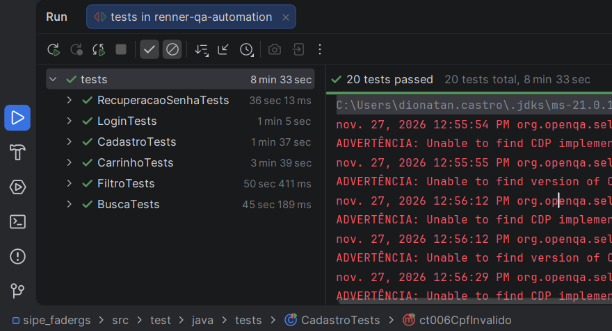

# Automação de Testes - Lojas Renner

Projeto de automação de testes funcionais End-to-End desenvolvido como estudo de caso para o **Projeto Científico FADERGS**.

A suíte utiliza **Java 21, Selenium WebDriver, JUnit 5, Maven e Page Object Model (POM)** para validar funcionalidades do e-commerce Lojas Renner.

## Resultado final

```text
20 testes executados
20 testes aprovados
0 falhas
Taxa de aprovação: 100%
Tempo aproximado: 9 min 2 s
```

---

## Objetivo

Desenvolver uma suíte de testes automatizados para validar fluxos relevantes de um e-commerce real, aplicando conceitos de Qualidade de Software, testes funcionais de caixa-preta e automação.

Funcionalidades cobertas:

- Login
- Cadastro
- Busca de produtos
- Filtros de pesquisa
- Carrinho de compras
- Recuperação de senha

---

## Tecnologias utilizadas

| Tecnologia | Versão | Finalidade |
|---|---:|---|
| Java | 21 | Linguagem principal |
| Selenium WebDriver | 4.34.0 | Automação web |
| JUnit 5 | 5.13.4 | Estrutura e execução dos testes |
| Maven | - | Gerenciamento de dependências |
| Maven Surefire Plugin | 3.5.3 | Execução dos testes |
| dotenv-java | 3.0.0 | Variáveis de ambiente |
| Google Chrome | - | Navegador utilizado |
| IntelliJ IDEA | - | Desenvolvimento e execução |
| Git / GitHub | - | Versionamento |
| Page Object Model | - | Arquitetura da automação |

---

## Arquitetura

O projeto utiliza **Page Object Model (POM)**, separando a lógica de interação com a interface dos casos de teste.

```text
src/test/java/
├── base/
│   └── BaseTest.java
├── pages/
│   ├── BasePage.java
│   ├── LoginPage.java
│   ├── CadastroPage.java
│   ├── BuscaPage.java
│   ├── FiltroPage.java
│   ├── CarrinhoPage.java
│   └── RecuperacaoSenhaPage.java
├── tests/
│   ├── LoginTests.java
│   ├── CadastroTests.java
│   ├── BuscaTests.java
│   ├── FiltroTests.java
│   ├── CarrinhoTests.java
│   └── RecuperacaoSenhaTests.java
└── utils/
    ├── ConfigReader.java
    └── DriverFactory.java
```

### BaseTest

Responsável por:

- criar uma nova instância do ChromeDriver antes de cada teste;
- acessar a página inicial;
- disponibilizar o WebDriver;
- finalizar o navegador após cada CT.

Cada teste é executado em uma nova sessão do navegador.

### BasePage

Centraliza métodos reutilizáveis:

```java
esperarVisivel()
esperarPresenca()
clicar()
clicarComJS()
rolarAte()
digitar()
```

As interações utilizam `WebDriverWait` e `ExpectedConditions`, com timeout padrão de 15 segundos.

### ConfigReader

As credenciais utilizadas no login válido são carregadas por variáveis de ambiente:

```env
APP_USER=usuario
APP_PASS=senha
```

O arquivo `.env` não deve ser versionado.

---

## Estratégia de testes

Foram aplicadas técnicas de caixa-preta como:

- Partição de Equivalência;
- Análise de Valor Limite;
- testes positivos e negativos;
- combinação de condições;
- transição de estados.

Como os testes são executados contra um ambiente real de produção, foram evitados fluxos que exigissem pagamento real, bypass de CAPTCHA, OTP, acesso a e-mail ou alteração efetiva de senha.

---

## Cobertura

| Módulo | Casos | Quantidade |
|---|---|---:|
| Login | CT001 a CT004 | 4 |
| Cadastro | CT005 a CT008 | 4 |
| Busca | CT009 a CT011 | 3 |
| Filtros | CT012 a CT014 | 3 |
| Carrinho | CT015 a CT018 | 4 |
| Recuperação de senha | CT019 e CT020 | 2 |
| **Total** | **CT001 a CT020** | **20** |

---

# Casos de Teste

## Login

### CT001 - E-mail ou Login inválido

**Pré-condições**
- Site acessível.
- Usuário não autenticado.
- Tela de login disponível.

**Massa de teste**

```text
Login: emailinvalido
Senha: Senha123
```

**Resultado esperado**

O sistema deve rejeitar a tentativa de autenticação.

**Resultado obtido**

A aplicação rejeitou a autenticação e apresentou orientação para tentar novamente.

**Status:** ✅ Aprovado

---

### CT002 - Senha vazia

**Pré-condições**
- Tela de login disponível.
- E-mail preenchido.

**Massa de teste**

```text
E-mail: teste@email.com
Senha: vazio
```

**Resultado esperado**

O sistema deve informar que a senha é obrigatória.

**Resultado obtido**

Foi apresentada mensagem contendo `obrigatório`.

**Status:** ✅ Aprovado

---

### CT003 - Credenciais inválidas ou fictícias

**Pré-condições**
- Usuário não autenticado.
- Tela de login disponível.

**Massa de teste**

```text
E-mail: usuario.ficticio@teste.com
Senha: SenhaFicticia123
```

**Resultado esperado**

O sistema não deve autenticar as credenciais informadas.

**Resultado obtido**

A aplicação apresentou retorno indicando credencial inválida.

**Status:** ✅ Aprovado

---

### CT004 - Login válido

**Pré-condições**
- Credenciais configuradas no arquivo `.env`.
- Conta disponível para execução.

**Massa de teste**

```text
APP_USER
APP_PASS
```

**Resultado esperado**

O login deve ser processado corretamente.

**Resultado obtido**

O fluxo de login foi executado e permaneceu no domínio das Lojas Renner.

**Status:** ✅ Aprovado

---

## Cadastro

### CT005 - Campos obrigatórios vazios

**Pré-condições**
- Formulário de cadastro disponível.

**Ação**

Tentar concluir o cadastro sem preencher os campos obrigatórios.

**Resultado esperado**

O sistema deve identificar os campos obrigatórios.

**Resultado obtido**

Foi apresentada a mensagem:

```text
este campo é obrigatório
```

**Status:** ✅ Aprovado

---

### CT006 - CPF inválido

**Pré-condições**
- Formulário de cadastro aberto.

**Massa de teste**

```text
CPF: 11111111111
```

**Resultado esperado**

O sistema deve rejeitar o CPF.

**Resultado obtido**

Foi apresentada validação indicando CPF inválido.

**Status:** ✅ Aprovado

---

### CT007 - E-mail em formato inválido

**Massa de teste**

```text
emailsemarroba.com
```

**Resultado esperado**

O formulário não deve aceitar o valor como e-mail válido.

**Resultado obtido**

A aplicação apresentou validação de formato inválido.

**Status:** ✅ Aprovado

---

### CT008 - Senha fora do padrão mínimo

**Massa de teste**

```text
Senha: 123
```

**Resultado esperado**

O sistema deve rejeitar a senha e informar a regra mínima.

**Resultado obtido**

Foi apresentada a mensagem:

```text
Ao menos 6 caracteres com letras e números
```

**Status:** ✅ Aprovado

---

## Busca de Produtos

### CT009 - Busca com termo válido

**Pré-condições**
- Página inicial acessível.
- Campo de busca disponível.

**Massa de teste**

```text
camiseta
```

**Resultado esperado**

O termo pesquisado deve ser apresentado e a listagem deve conter produtos.

**Resultado obtido**

O sistema apresentou o termo pesquisado e retornou produtos.

**Status:** ✅ Aprovado

---

### CT010 - Busca por termo sem correspondência direta

**Massa de teste**

```text
produtoautomatizadoinexistente987654
```

**Resultado esperado**

A busca deve tratar a consulta sem apresentar erro.

**Resultado obtido**

A Renner processou a consulta e retornou produtos por mecanismo de relevância/fallback, mantendo o termo pesquisado.

**Status:** ✅ Aprovado

---

### CT011 - Busca com campo vazio

**Técnica**

Análise de Valor Limite: zero caracteres.

**Resultado esperado**

A aplicação deve processar a ação sem erro técnico.

**Resultado obtido**

O sistema navegou para:

```text
/b?Ntt=
```

e apresentou uma listagem de produtos.

**Status:** ✅ Aprovado

---

## Filtros de Pesquisa

**Pré-condição geral**

Os testes partem de uma busca por:

```text
camiseta
```

---

### CT012 - Aplicar filtro de gênero masculino

**Ação**

```text
FILTRAR E ORDENAR
→ Gênero
→ Masculino
→ APLICAR
```

**Resultado esperado**

A listagem deve ser atualizada após a aplicação do filtro.

**Resultado obtido**

A aplicação processou o filtro e apresentou produtos.

**Status:** ✅ Aprovado

---

### CT013 - Aplicar gênero e tamanho

**Filtros**

```text
Gênero: Masculino
Tamanho: G
```

**Resultado esperado**

Os dois critérios devem ser processados simultaneamente.

**Resultado obtido**

A combinação foi aplicada e a listagem permaneceu disponível.

**Status:** ✅ Aprovado

---

### CT014 - Limpar filtros

**Pré-condições**
- Filtros `Masculino` e `G` previamente aplicados.

**Ação**

```text
Reabrir filtros
→ LIMPAR FILTROS
```

**Resultado esperado**

A listagem deve retornar ao estado sem os critérios aplicados.

**Resultado obtido**

Os filtros foram removidos e a listagem de produtos voltou a ser apresentada.

**Status:** ✅ Aprovado

---

## Carrinho de Compras

**Pré-condição geral**

Os testes utilizam um produto obtido pela busca de `camiseta`, selecionando um tamanho disponível antes da inclusão na sacola.

---

### CT015 - Adicionar produto ao carrinho

**Ação**

```text
Buscar produto
→ abrir produto
→ selecionar tamanho
→ adicionar à sacola
```

**Resultado esperado**

O produto deve ser adicionado à sacola.

**Resultado obtido**

A página `Minha Sacola` foi carregada corretamente.

**Status:** ✅ Aprovado

---

### CT016 - Alterar quantidade

**Pré-condições**
- Produto presente na sacola.

**Resultado esperado**

A quantidade deve ser alterada mantendo o usuário na sacola.

**Resultado obtido**

A operação foi processada e a aplicação permaneceu na rota `/sacola`.

**Status:** ✅ Aprovado

---

### CT017 - Remover produto

**Pré-condições**
- Produto presente na sacola.

**Resultado esperado**

A sacola deve retornar ao estado vazio.

**Resultado obtido**

Foi apresentada a mensagem:

```text
Sua sacola está vazia
```

**Status:** ✅ Aprovado

---

### CT018 - Aplicar cupom inválido

**Massa de teste**

```text
RENNER2026
```

**Resultado esperado**

O cupom deve ser rejeitado.

**Resultado obtido**

Foi apresentada a mensagem:

```text
Cupom de desconto inválido
```

**Status:** ✅ Aprovado

---

## Recuperação de Senha

O fluxo atual utiliza CPF para iniciar a recuperação.

A automação termina antes de acessar e-mail ou alterar efetivamente a senha.

---

### CT019 - CPF inválido

**Pré-condições**
- Usuário não autenticado.
- Funcionalidade `Esqueci minha senha` disponível.

**Massa de teste**

```text
000.000.000-00
```

**Resultado esperado**

O sistema deve rejeitar o CPF.

**Resultado obtido**

Foi apresentada a mensagem:

```text
CPF inválido!
```

**Status:** ✅ Aprovado

---

### CT020 - Solicitar recuperação de senha

**Pré-condições**
- Modal de recuperação disponível.

**Massa utilizada**

```text
012.345.678-90
```

**Resultado esperado**

O sistema deve processar a solicitação e apresentar o próximo estado do fluxo.

**Resultado obtido**

Foi apresentada mensagem equivalente a:

```text
Se você tem uma conta na Renner,
vamos enviar um link no seu e-mail
para você alterar sua senha.
```

A automação é finalizada nesse ponto.

**Status:** ✅ Aprovado

---

# Resultado consolidado

A suíte completa foi executada pelo runner JUnit do IntelliJ IDEA.

```text
20 tests passed
20 tests total
Tempo aproximado: 9 min 2 s
Taxa de aprovação: 100%
```

| Módulo | Resultado |
|---|---:|
| Login | 4/4 |
| Cadastro | 4/4 |
| Busca | 3/3 |
| Filtros | 3/3 |
| Carrinho | 4/4 |
| Recuperação de senha | 2/2 |
| **Total** | **20/20** |

---

## Evidência

A execução final apresentou todos os 20 CTs aprovados.

Sugestão para armazenar a evidência no repositório:

```text
docs/
└── evidencias/
    └── execucao-20-testes.png
```

Para exibir a imagem no README:

```markdown

```

---

## Execução dos testes

### IntelliJ IDEA

Para executar a suíte completa:

```text
src/test/java
→ package tests
→ Run 'Tests in tests'
```

### Maven

Quando Maven estiver configurado no `PATH`:

```bash
mvn test
```

---

## Observações de execução

### Navegador minimizado

Durante os testes foi identificado comportamento intermitente quando a janela do Chrome era minimizada.

Sem alteração do código, CTs que falharam com o navegador minimizado passaram normalmente com a janela ativa.

A execução final validada foi realizada mantendo o Chrome aberto e não minimizado:

```text
20/20 testes aprovados
```

Para reproduzir o ambiente validado:

- manter o Chrome maximizado;
- não minimizar durante a execução;
- não interagir manualmente com o navegador controlado pelo WebDriver.

### reCAPTCHA

O projeto não implementa bypass do reCAPTCHA.

Quando a validação automática não é possível, pode ser registrada a mensagem:

```text
reCAPTCHA não validado automaticamente.
```

### Chrome DevTools Protocol

Com Chrome 158 e Selenium 4.34.0 pode ser apresentado:

```text
Unable to find CDP implementation matching 158
```

Esse warning não impediu a execução dos recursos utilizados pela suíte nem a aprovação dos 20 CTs.

---

## Limitações

Por utilizar a aplicação real das Lojas Renner, futuras execuções podem ser afetadas por:

- alterações no DOM;
- mudanças de layout;
- campanhas promocionais;
- alterações no catálogo;
- overlays;
- CAPTCHA;
- tempo de resposta da aplicação;
- atualizações do Chrome;
- alterações nos fluxos de autenticação;
- carregamento assíncrono de componentes.

Por esse motivo, a suíte evita depender de valores muitoexata de produtos.

---

## Melhorias futuras

- GitHub Actions para CI/CD;
- screenshots automáticos em falhas;
- relatórios com Allure Report;
- atualização de compatibilidade Selenium/Chrome;
- testes parametrizados;
- execução cross-browser;
- testes de API;
- Selenium Grid;
- análise de execução headless;
- monitoramento de flakiness.

---

## Autor

**Dionatan Henrique Santos de Castro**

Projeto desenvolvido como estudo de caso para o **Projeto Científico FADERGS**.

[Repositório no GitHub](https://github.com/dionatanhc/sipe_fadergs)
